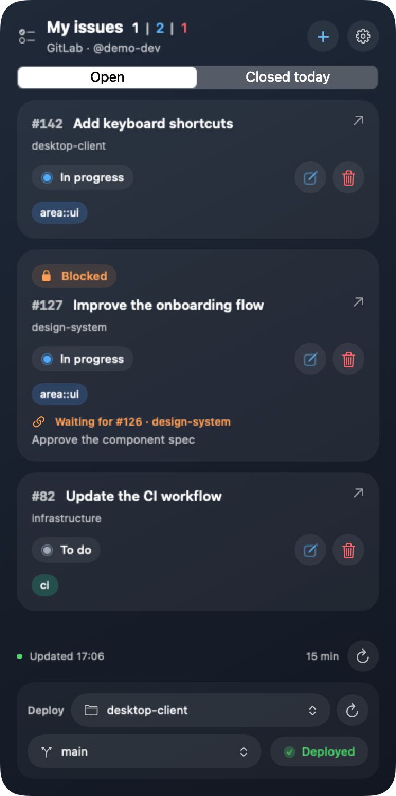
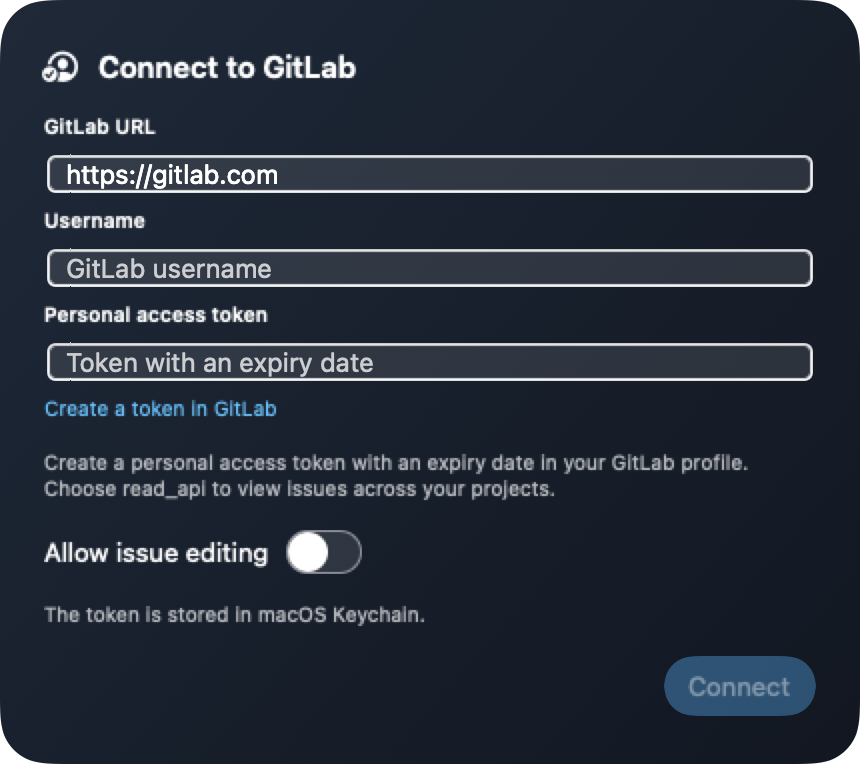
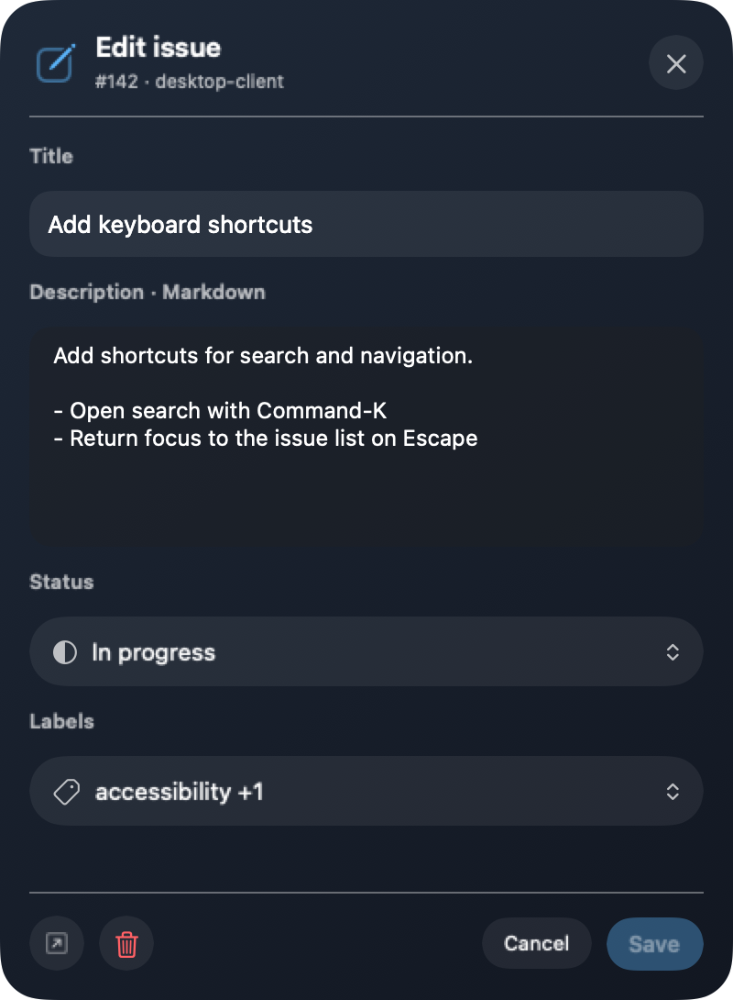

# GitLab Issues Widget for macOS

[Русский](README.md) · **English**

A native macOS desktop widget for the GitLab issues assigned to you. See your work across projects, spot blockers, and update issues from your desktop.

[Get the app](#get-the-app) · [Quick start](#quick-start) · [Troubleshooting](#troubleshooting)

*The screenshots show the English interface with demo data.*

## Features

- See your open issues and issues closed today across all projects your account can access. The closed-today view uses your Mac’s time zone.
- See active blockers and open linked issues in GitLab.
- Create issues assigned to yourself, edit titles and Markdown descriptions, and search project labels and available statuses as you type. Deleting an issue requires GitLab to confirm your permission.
- Track the latest deployment of a selected project and branch. This selection is independent of your issue list.
- Refresh issues automatically every 15 minutes or on demand. After GitLab confirms a change, the editor closes and the widget refreshes.
- Place the panel on the left side of your desktop, adjust the space reserved for other widgets, and optionally launch it when you log in.

## Get the app

The app requires **macOS 13 Ventura or later**. The ZIP includes a universal build for **Apple Silicon and Intel**. The app connects to **GitLab.com** or a **self-managed GitLab** instance over HTTPS.

1. [Download GitLab Issues 3.1.2 for macOS](https://github.com/Ramramramzes/gitlab-issues-widget/releases/download/v3.1.2/GitLab-Issues-3.1.2-macOS.zip).
2. Extract the ZIP and move **GitLab Issues.app** to **Applications**.
3. Open the app. The checklist icon in the menu bar opens the widget and its settings.

To use English, open **Widget settings** (`Настройки виджета…`), then select **English** under **Language** (`Язык`). The change takes effect immediately and the app remembers your selection.

This release uses an ad hoc signature and has no Apple notarization. If macOS blocks the first launch, use **System Settings → Privacy & Security → Open Anyway** to approve the app. [Apple’s instructions](https://support.apple.com/en-us/102445)

## Quick start

### 1. Create your personal access token

In the GitLab account you want to connect, open **Edit profile → Access → Personal access tokens**. On versions that distinguish token types, choose **Generate token → Legacy token**. Name it, for example `GitLab Issues Widget`, set an expiry date, and select one of the scopes below. Copy the generated token when GitLab shows it.

| How you want to use the widget | Token scope | Setting in the widget |
| --- | --- | --- |
| View issues, blockers, and available deployment data | `read_api` | Leave **Allow issue editing** off |
| Create and edit issues, or delete issues when permitted | `api` | Turn **Allow issue editing** on |

Create the token in your **user profile** so the widget can list issues assigned to you across projects. A token created under a single project or group is scoped to that resource. Start with `read_api` if you only need the issue list. The classic `api` scope grants broad API read and write access within your account’s GitLab permissions. GitLab still checks your project permissions for every change. [GitLab token setup](https://docs.gitlab.com/user/profile/personal_access_tokens/) · [GitLab token scopes](https://docs.gitlab.com/security/tokens/access_token_scopes/)

### 2. Connect the widget

1. Open the app and choose **Connect GitLab** (`Подключить GitLab`). If an account is already connected, open **GitLab connection** (`Подключение GitLab…`) from the menu bar.
2. Enter your GitLab instance’s **HTTPS base URL**, for example `https://gitlab.com` or `https://gitlab.example.org/gitlab`. Use the GitLab installation address. Leave out individual project paths and `/api/v4`.
3. Enter your **GitLab username** and paste the token. The widget verifies that the token belongs to the username you entered.
4. For an `api` token, turn on **Allow issue editing** (`Разрешить редактирование задач`) if you want to make changes. Click **Connect** (`Подключить`).
5. Check that your username appears in the widget header. The **Open** and **Closed today** views are labeled `Открытые` and `Закрытые сегодня`.

### 3. Work with your issues

Click an issue’s title or the arrow on its card to open it in GitLab. With editing enabled, use **+** to create an issue or the pencil control on a card to edit it. Pick a project when creating an issue. The widget assigns the issue to your connected account so it appears in your list. Use the selectors in the deployment section to monitor a project and branch.

## GitLab compatibility

The issue list and basic editing use GitLab’s REST API. The widget uses the Work Items GraphQL API for native statuses where the server, project, and account support them. On instances without the required GraphQL fields, basic editing is available through REST with title, description, labels, and open or closed state. Native work item statuses depend on the GitLab version and configuration. Issue deletion in the widget requires GitLab to expose and grant the corresponding Work Items permission. [GitLab Issues API](https://docs.gitlab.com/api/issues/)

Use a classic personal access token for the setup described here. Fine-grained token permissions vary by GitLab version and must cover the current user, the cross-project issue list, and the endpoints needed by any enabled feature.

## Account and token storage

The widget stores your connection in **macOS Keychain** and restores it on launch. It calls the configured GitLab instance directly over HTTPS and rejects API redirects. To switch accounts or replace an expired token, reopen the connection dialog and enter the new credentials. Choose **Sign out** in **Widget settings** to clear the saved connection on this Mac. Revoke the token in GitLab if you also want to invalidate it on the server.

## Troubleshooting

| What you see | What to check |
| --- | --- |
| GitLab reports an invalid token or HTTP 401 | Check that the token is current, comes from the instance you entered, and belongs to the username in the connection dialog. |
| The issue list won’t load or GitLab returns HTTP 403 | Use a personal token with `read_api` or `api`. Check your instance’s token policy, project access, and VPN if required. |
| The list is empty | In GitLab, check that at least one issue is assigned to the connected account. Use **Closed today** for issues closed today in your local time zone. |
| Editing is disabled or GitLab rejects a change | Connect with `api`, enable **Allow issue editing**, and confirm that your GitLab account can perform the same action in that project. |
| GitLab returns HTTP 404 during setup | Use the HTTPS base URL of your GitLab installation. Include its installation subpath if it has one. |
| The server redirects to a sign-in page | Connect to the network or VPN that gives the app direct, token-authenticated access to your GitLab API. |

When [reporting an issue](https://github.com/Ramramramzes/gitlab-issues-widget/issues), include your macOS version, GitLab version, and the error message with any private details removed.

## Local build

On macOS with Command Line Tools installed, run `bash app/build.sh`. The app appears in the `app` directory.

Run the checks with `python3 app/test_blockers.py`.

### Source layout

- `app/main.swift` is the application entry point.
- `app/Sources/Application` and `app/Sources/Widget` handle menus, windows, desktop placement, and widget state.
- `app/Sources/Connection` and `app/Sources/GitLab` handle connection setup, Keychain storage, HTTP transport, and the REST and GraphQL clients.
- `app/Sources/Issues` and `app/Sources/Deployment` contain the issue and deployment features.
- `app/Sources/Shared` contains reusable views and localization.
- `app/Tests` contains logic tests and tests with mocked GitLab responses. They compile against the app sources and use their own entry point.
