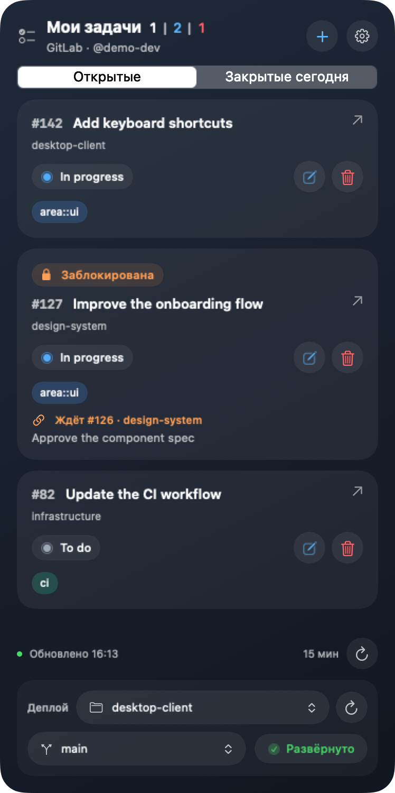
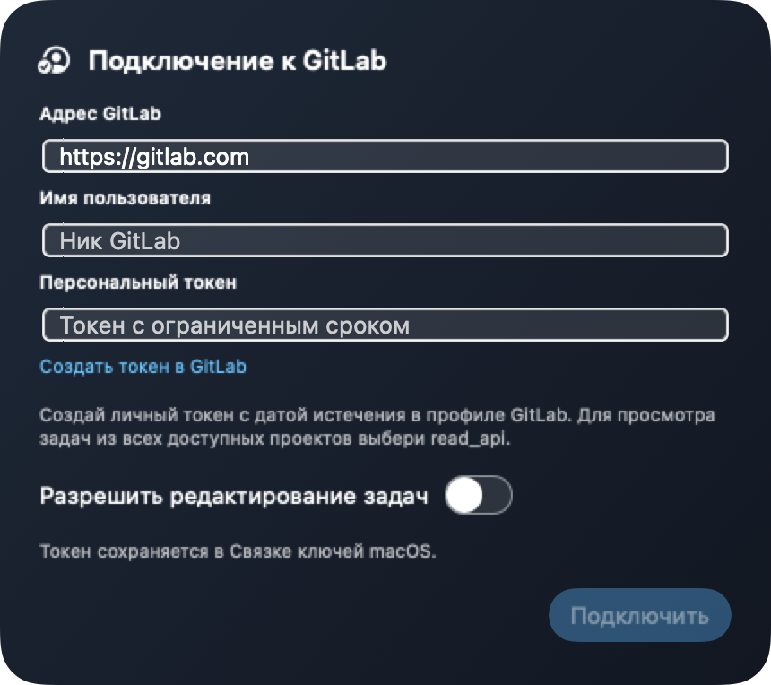
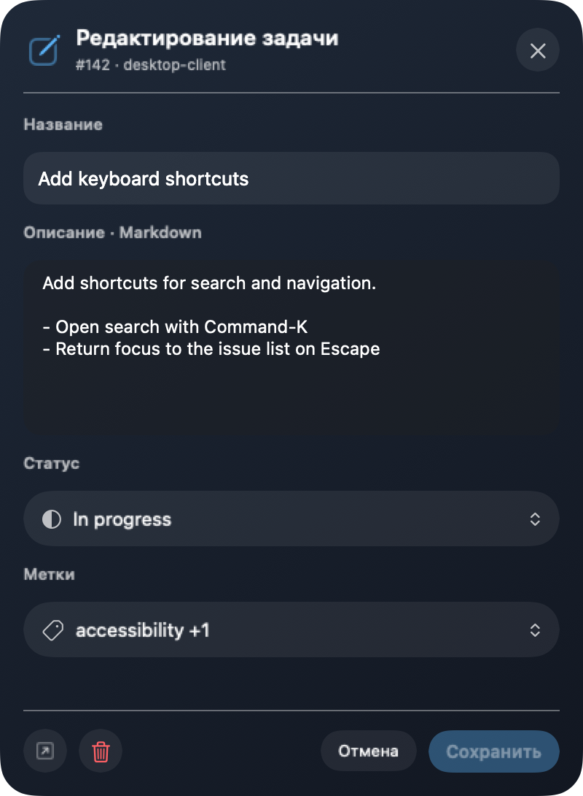

# GitLab Issues для macOS

**Русский** · [English](README.en.md)

Виджет рабочего стола macOS для задач, назначенных вам в GitLab. Просматривайте задачи из разных проектов, замечайте блокировки и вносите изменения прямо с рабочего стола.

[Установка](#установка) · [Быстрый старт](#быстрый-старт) · [Решение проблем](#решение-проблем)

*На скриншотах показаны демонстрационные данные.*

## Возможности

- Просматривайте открытые и закрытые сегодня задачи из всех доступных проектов. Граница дня определяется часовым поясом macOS.
- Смотрите, какие задачи блокируют работу, и открывайте связанные задачи в GitLab.
- Создавайте задачи с назначением на себя и редактируйте названия и описания в Markdown. Поиск помогает выбрать статус и метки. Удаление доступно при наличии соответствующего права в GitLab.
- Отслеживайте последний деплой выбранного проекта и ветки. Этот выбор независим от списка задач.
- Задачи обновляются автоматически каждые 15 минут. Список можно обновить вручную. После того как GitLab подтвердит изменение, редактор закрывается, а список обновляется.
- Размещайте виджет у левого края рабочего стола, оставляйте место для других виджетов и включайте запуск при входе в macOS.

## Установка

Требуется **macOS 13 Ventura или новее**. В ZIP находится универсальная сборка для **Apple Silicon и Intel**. Виджет подключается к **GitLab.com** или к вашему серверу **GitLab** по HTTPS.

1. [Скачайте ZIP с GitLab Issues 3.1.1](https://github.com/Ramramramzes/gitlab-issues-widget/releases/download/v3.1.1/GitLab-Issues-3.1.1-macOS.zip).
2. Распакуйте архив и перенесите **GitLab Issues.app** в папку **«Программы»**.
3. Откройте приложение. Иконка списка в строке меню открывает виджет и его настройки.

Язык интерфейса меняется сразу в **«Настройки виджета» → «Язык»**. Выбор сохраняется между запусками.

Сборка использует подпись ad hoc и выпущена без нотарификации Apple. Если macOS заблокирует первый запуск, откройте **«Системные настройки» → «Конфиденциальность и безопасность» → «Открыть всё равно»**. [Инструкция Apple](https://support.apple.com/ru-ru/102445)

## Быстрый старт

### 1. Создайте персональный токен

Войдите в нужный аккаунт GitLab и откройте **Edit profile → Access → Personal access tokens**. В версиях с выбором типа токена нажмите **Generate token → Legacy token**. Задайте название, например `GitLab Issues Widget`, выберите срок действия и одно из прав ниже. Скопируйте токен, когда GitLab покажет его.

| Что нужно делать в виджете | Право токена | Настройка виджета |
| --- | --- | --- |
| Просматривать задачи, блокировки и доступные данные о деплоях | `read_api` | Оставьте **«Разрешить редактирование задач»** выключенным |
| Создавать, редактировать и удалять задачи при наличии прав | `api` | Включите **«Разрешить редактирование задач»** |

Создайте токен в **профиле пользователя**, чтобы видеть назначенные вам задачи из разных проектов. Токен отдельного проекта или группы действует в пределах этого проекта или группы. Для просмотра достаточно `read_api`. Классическое право `api` даёт широкий доступ к чтению и записи через API в пределах прав вашего аккаунта. GitLab проверяет права проекта при каждом изменении. [Создание токена](https://docs.gitlab.com/user/profile/personal_access_tokens/) · [Права токенов](https://docs.gitlab.com/security/tokens/access_token_scopes/)

### 2. Подключите виджет

1. Откройте приложение и нажмите **«Подключить GitLab»**. Если аккаунт уже подключён, выберите **«Подключение GitLab…»** в строке меню.
2. Укажите **HTTPS-адрес сервера**, например `https://gitlab.com` или `https://gitlab.example.org/gitlab`. Используйте адрес установки GitLab без пути к отдельному проекту и суффикса `/api/v4`.
3. Введите **имя пользователя GitLab** и вставьте токен. Виджет проверит, что токен принадлежит указанному аккаунту.
4. Чтобы вносить изменения с токеном `api`, включите **«Разрешить редактирование задач»**. Нажмите **«Подключить»**.
5. Проверьте, что ваше имя пользователя появилось в заголовке. Списки задач находятся во вкладках **«Открытые»** и **«Закрытые сегодня»**.

### 3. Работайте с задачами

Нажмите название задачи или стрелку на карточке, чтобы открыть задачу в GitLab. При включённом редактировании кнопка **+** создаёт задачу, а иконка карандаша на карточке открывает редактор. При создании выберите проект. Виджет назначит задачу на подключённый аккаунт, чтобы она появилась в вашем списке. Проект и ветку для отслеживания деплоев можно выбрать в блоке **«Деплой»**.

## Совместимость с GitLab

Список задач и базовое редактирование работают через REST API GitLab. Виджет использует Work Items GraphQL API для встроенных статусов, если это поддерживают версия сервера, проект и ваш аккаунт. Если нужные поля GraphQL недоступны, через REST можно изменить название, описание, метки и состояние задачи — открыта или закрыта. Удаление через виджет доступно, когда GitLab подтверждает право удаления через Work Items API. [GitLab Issues API](https://docs.gitlab.com/api/issues/)

Описанная настройка рассчитана на классический персональный токен. Для токенов с детальными правами набор разрешений зависит от версии GitLab. Токену нужен доступ к текущему пользователю, общему списку задач и API выбранных функций.

## Аккаунт и хранение токена

Виджет сохраняет подключение в **Связке ключей macOS** и восстанавливает его при запуске. Он обращается к указанному серверу GitLab напрямую по HTTPS и отклоняет переадресации API. Чтобы сменить аккаунт или обновить токен, снова откройте окно подключения и введите новые данные. Кнопка **«Выйти из аккаунта»** в **«Настройках виджета»** удаляет сохранённое подключение с этого Mac. Чтобы отозвать токен на сервере, откройте настройки токенов в GitLab.

## Решение проблем

| Что произошло | Что проверить |
| --- | --- |
| GitLab сообщает об ошибке токена или возвращает HTTP 401 | Проверьте срок действия токена, адрес сервера и имя аккаунта, выпустившего токен. |
| Список не загружается или GitLab возвращает HTTP 403 | Используйте персональный токен с `read_api` или `api`. Проверьте правила сервера, доступ к проектам и подключение к VPN, если оно требуется. |
| Список пуст | Проверьте, что в GitLab есть задачи, назначенные подключённому аккаунту. Для задач, закрытых сегодня по времени вашего Mac, откройте вкладку **«Закрытые сегодня»**. |
| Редактирование недоступно или GitLab отклоняет изменение | Подключите токен с `api`, включите **«Разрешить редактирование задач»** и проверьте, что ваш аккаунт может выполнить то же действие в проекте GitLab. |
| GitLab возвращает HTTP 404 при подключении | Укажите HTTPS-адрес установки GitLab, включая подкаталог установки, если он есть. |
| Сервер переадресовывает на страницу входа | Подключитесь к сети или VPN, через которые API GitLab доступен напрямую с токеном. |

В сообщении об ошибке укажите версии macOS и GitLab и приложите текст ошибки без токенов и закрытых данных. [Сообщить об ошибке](https://github.com/Ramramramzes/gitlab-issues-widget/issues)

## Локальная сборка

На macOS с установленными Command Line Tools выполните `bash app/build.sh`. Готовое приложение появится в папке `app`.

Проверки запускаются командой `python3 app/test_blockers.py`.

### Структура исходников

- `app/main.swift` — точка входа в приложение.
- `app/Sources/Application` и `app/Sources/Widget` — меню, окна, размещение на рабочем столе и состояние виджета.
- `app/Sources/Connection` и `app/Sources/GitLab` — подключение, Связка ключей, HTTP-транспорт и клиенты REST и GraphQL.
- `app/Sources/Issues` и `app/Sources/Deployment` — задачи, редактор и отслеживание деплоев.
- `app/Sources/Shared` — общие элементы интерфейса и локализация.
- `app/Tests` — проверки логики и запросов с имитацией ответов GitLab. Они компилируются вместе с исходниками приложения и используют собственную точку входа.
